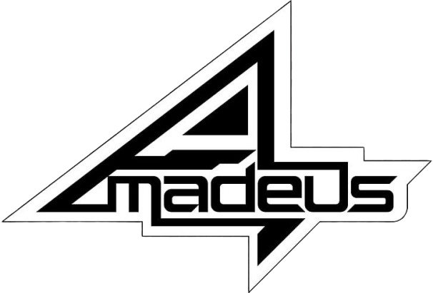

<p align="center">
  
</p>

<h1 align="center">Amadeus</h1>

<p align="center">
  <strong>A portable, terminal-first local AI agent inspired by Steins;Gate.</strong><br>
  Built for coding, command execution, and file manipulation on 6–8 GB VRAM GPUs.
</p>

<p align="center">
  <a href="LICENSE"></a>
  
  
  
</p>

---

## What is Amadeus?

Amadeus is an autonomous, open-source AI agent designed to run entirely on your local hardware. Named after the digitized artificial intelligence system from *Steins;Gate* (modeled after neuroscientist Kurisu Makise), Amadeus blends sharp analytical reasoning, dry wit, and scientific precision with robust tool-assisted execution.

### Key Highlights

- **100% Local & Private**: No cloud telemetry or subscription locks. Powered by `llama.cpp` (`llama-server`) with full NVIDIA CUDA acceleration, plus automatic fallback to Ollama or any OpenAI-compatible server.
- **Tuned for 6–8 GB VRAM**: Engineered to run state-of-the-art ~7–9B dense models and ~20–35B Mixture-of-Experts (MoE) architectures with CPU offload (`--n-cpu-moe`) on standard consumer gaming PCs (e.g. RTX 3070 / 4060 / 3060).
- **One-Command Model Hot-Swapping**: Switch models on the fly in the middle of a session (`/model <name>` or `amadeus model use`) with automatic VRAM reclamation and process lifecycle management.
- **Portable & Clean (Single-Folder Design)**: Zero pollution of `%APPDATA%`, `~`, or user home directories. The entire runtime (`.runtime/`), binaries (`bin/`), models (`models/`), and data (`data/`) live inside the cloned repository folder. Moving the folder? Simply run `amadeus repair`. Uninstalling? Just delete the folder.
- **Persistent Cross-Model Memory**: Human-readable Markdown memory (`data/memory/`) that persists across model changes and sessions. Features automatic token budgeting, deduplication, and fast BM25 retrieval without hungry embedding models.
- **Safe & Controllable**: Three execution modes (`ask`, `auto`, `yolo`) with syntax-highlighted diff previews for file modifications, explicit confirmation prompts for shell commands, and a strict hardcoded denylist preventing catastrophic system actions.
- **Steins;Gate Kurisu Persona**: An original, carefully crafted system prompt capturing Kurisu Makise’s intellectual rigor, sarcasm, light tsundere deflections, and Easter eggs—with a `--persona plain` switch when pure neutrality is desired.

---

## System Architecture

```
Amadeus/
├── amadeus.cmd               # Portable launcher shim
├── amadeus.ps1               # Launcher & environment repair
├── setup.ps1                 # Automated one-step setup
├── uninstall.ps1             # Clean uninstaller with optional model backup
├── pyproject.toml            # Project packaging & dependencies
├── assets/                   # Logos and precomputed Braille terminal banners
├── docs/                     # Architecture contracts & technical specifications
├── src/amadeus/
│   ├── config.py             # Settings & model profile registry (TOML)
│   ├── safety.py             # Execution policy & hardened command denylist
│   ├── memory.py             # Persistent user memory (profile, preferences, notes)
│   ├── ui.py                 # Rich console, crimson gradients, diffs, approval prompts
│   ├── persona/              # Persona prompts (amadeus.md & plain.md)
│   └── tools/                # Registered agent tools
│       ├── shell.py          # Secure PowerShell/Bash command execution
│       ├── files.py          # read_file, write_file (with diffs), edit_file, list_dir
│       ├── search.py         # glob and grep (rg with Python fallback)
│       ├── web.py            # Untrusted sandboxed web fetch
│       └── memory_tools.py   # remember, recall, forget
└── tests/                    # 128+ passing unit tests
```

---

## Quick Start (Windows)

### Prerequisites
- Windows 10/11 x64
- NVIDIA GPU (6 GB+ VRAM recommended; CPU fallback supported)
- Git & PowerShell 5.1+

### Installation

Clone the repository and run the setup script:

```powershell
git clone https://github.com/Aestivial/Amadeus.git
cd Amadeus
.\setup.ps1
```

`setup.ps1` will:
1. Download a standalone, folder-local `uv` binary into `.runtime/` (no global system changes).
2. Provision a local Python 3.12 environment in `.runtime/venv`.
3. Set up folder structures (`models/`, `data/memory/`, `bin/llama.cpp/`).
4. Optionally add Amadeus to your user `PATH`.

---

## Basic Usage

Launch Amadeus from the project root:

```powershell
.\amadeus.cmd
```

Or from any directory if added to your `PATH`:

```powershell
amadeus
```

### Slash Commands inside the REPL
- `/model <profile>`: Hot-swap to a different model (e.g. `/model coder` or `/model power`).
- `/models`: List available model profiles and active runtime status.
- `/mode <ask|auto|yolo>`: Change the safety permission level on the fly.
- `/memory`: Inspect current persistent memory state.
- `/persona <amadeus|plain>`: Toggle Kurisu's persona.
- `/clear`: Clear the current turn context while keeping memory intact.
- `/help`: Show command documentation.
- `/exit`: Terminate session cleanly.

---

## Model Profiles

Model profiles are defined in `src/amadeus/models.toml` and customizable in `data/models.toml`:

| Profile | Target Architecture | VRAM / RAM Target | Focus |
|---|---|---|---|
| **`general`** | Qwen 3.5 9B (Q4_K_M) | 8 GB VRAM | Fast general reasoning, tool use, terminal control |
| **`power`** | Qwen 3.6 35B-A3B MoE | 8 GB VRAM + 16–32 GB RAM | Deep reasoning via RAM expert offload (`--n-cpu-moe`) |
| **`coder`** | Qwen 2.5 Coder 7B | 6–8 GB VRAM | Targeted code generation and repository refactoring |
| **`lite`** | Qwen 3.5 4B (Q4_K_M) | 4 GB VRAM / CPU | Low-resource machines, laptops, and CPU fallback |

---

## Safety & Permissions

Amadeus defaults to **`ask`** mode:
- **Read operations** (`read_file`, `list_dir`, `glob`, `grep`, `recall`): Auto-approved.
- **Write operations** (`write_file`, `edit_file`): Display unified diff previews and require confirmation.
- **Execution & Network** (`shell`, `web_fetch`): Display exact commands/URLs and require confirmation.
- **Destructive Command Denylist**: Commands attempting recursive deletion of drive roots, user homes, system directories, or disk operations (`format`, `diskpart`, `rm -rf /`, `del C:\*`) are hard-blocked in **all** modes, including `yolo`.

---

## Project Status & Roadmap

- [x] **Phase 1: Foundation & Contracts**
  - Portable folder-local environment launcher (`amadeus.cmd`, `amadeus.ps1`, `setup.ps1`, `uninstall.ps1`, `repair`).
  - Configuration & Model Profile Registry (`config.py`, `models.toml`).
  - Safety policy engine & command denylist (`safety.py`).
  - Core agent tools (`shell`, `files`, `search`, `web`).
  - Persistent Markdown memory system & tools (`memory.py`, `memory_tools.py`).
  - Steins;Gate Kurisu persona prompts & Unicode Braille banner system (`ui.py`, `assets/`).
  - Automated test suite (128 passing unit tests).
- [ ] **Phase 2: Runtime Engine & Agent Loop (Next Milestone)**
  - Automated `llama.cpp` CUDA binary downloader & process supervisor (`runtime/llamacpp.py`).
  - Hugging Face GGUF downloader with progress tracking (`runtime/hf.py`).
  - Ollama fallback connector (`runtime/ollama.py`).
  - Multi-turn ReAct agent loop with streaming token delivery (`agent.py`, `llm/client.py`).
  - Interactive prompt_toolkit REPL with syntax highlighting and auto-completion (`repl.py`).
  - Environment diagnostic command (`amadeus doctor`).
- [ ] **Phase 3: Extended Features**
  - Project-specific instructions (`AMADEUS.md`).
  - Voice integration option.
  - Optional local web dashboard (`amadeus serve`).

---

## License

This project is licensed under the **GNU General Public License v3.0 (GPL-3.0)**. See the [LICENSE](LICENSE) file for details.
